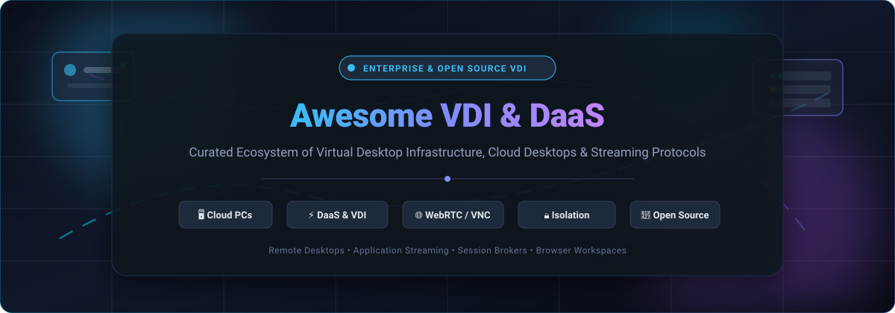
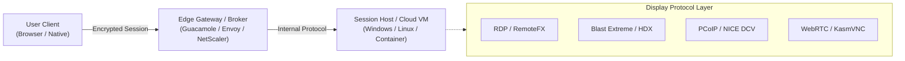

  

  
  
  
  
  
  

---

# 🖥️ Awesome Virtual Desktop Infrastructure (VDI) & DaaS Ecosystem

> A carefully curated collection of enterprise **Desktop-as-a-Service (DaaS)** platforms, **Virtual Desktop Infrastructure (VDI)** brokers, open-source streaming protocols, web-native browser isolation containers, and session delivery gateways.

Welcome to the definitive hub for end-user computing (EUC) architects, systems engineers, cybersecurity teams, and DevOps practitioners designing modern remote workspaces, cloud PCs, and secure application streaming architectures.

---

## 📑 Table of Contents

- [📊 Sector Overview &amp; Market Dynamics](#-sector-overview--market-dynamics)
- [☁️ Enterprise SaaS &amp; Hosted DaaS Platforms](#️-enterprise-saas--hosted-daas-platforms)
- [⚡ Open-Source VDI &amp; Remote Streaming Solutions](#-open-source-vdi--remote-streaming-solutions)
- [📡 Streaming Protocols &amp; Technologies Guide](#-streaming-protocols--technologies-guide)
- [🎯 Architecture &amp; Enterprise Use Cases](#-architecture--enterprise-use-cases)
- [❓ Frequently Asked Questions (FAQ)](#-frequently-asked-questions-faq)
- [🤝 How to Contribute](#-how-to-contribute)
- [⭐ Star History](#-star-history)
- [💖 Support &amp; Community](#-support--community)
- [📜 License &amp; Disclaimer](#-license--disclaimer)

---

## 📊 Sector Overview & Market Dynamics

The global **Virtual Desktop Infrastructure (VDI)** and **Desktop-as-a-Service (DaaS)** market reached an estimated **$16.4 Billion in 2024** and is projected to surpass **$38.2 Billion by 2030**, advancing at a Compound Annual Growth Rate (**CAGR**) of **15.2%**. Rapid market expansion is driven by universal hybrid work policies, zero-trust remote access compliance mandates, enterprise migration from legacy on-premises servers to cloud hyperscalers, and rising demand for GPU-accelerated cloud engineering workstations.

The sector exhibits **moderate-to-high concentration** at the Fortune 500 enterprise tier—dominated by hyper-scale public clouds and legacy virtualization titans (**Microsoft**, **Amazon Web Services**, **Citrix / Cloud Software Group**, and **VMware / Omnissa**) due to entrenched Active Directory / Entra ID identity ecosystems, Windows OS licensing advantages, and worldwide multi-region datacenters. Conversely, the developer, educational, and mid-market ecosystem remains **moderately fragmented**, with accelerating adoption of modern containerized browser-native streaming platforms (**Kasm Workspaces**, **Selkies**), decentralized open-source remote access tools (**RustDesk**, **Apache Guacamole**), and on-demand GPU cloud infrastructure (**CoreWeave / Paperspace**, **Vagon**).

---

## ☁️ Enterprise SaaS & Hosted DaaS Platforms

The following table presents leading commercial SaaS and managed Desktop-as-a-Service providers. The table is **sorted in descending order by company size** (market capitalization or private valuation).

| 🏢 Product / Platform | 🏭 Provider / Parent | 💰 Company Size / Valuation | 💳 Starting Pricing | 🎁 Free Tier / Trial Limits | 🚀 Key Capabilities &amp; Workloads |
| :--- | :--- | :--- | :--- | :--- | :--- |
| **[Windows 365 &amp; Azure Virtual Desktop](https://www.microsoft.com/en-us/windows-365)** | Microsoft Corporation | **~$3.12 Trillion** Market Cap *(~$245B+ Annual Revenue)* | **$28.00/user/month** *(Windows 365 Business: 1 vCPU, 2 GB RAM, 64 GB storage with Hybrid Benefit)*; AVD compute starts at **~$0.04/vCPU-hour** *(~$18.50 - $27.00/user/month pooled)* | **30-day free trial** *(Windows 365 Enterprise: up to 3 licenses of 2 vCPU / 8 GB RAM / 128 GB)*; **$200 free Azure credits for 30 days** for AVD | Deep Microsoft 365 integration, Entra ID SSO, multi-session Windows 11, Intune device management, Microsoft Teams AV redirection. |
| **[Amazon WorkSpaces &amp; AppStream 2.0](https://aws.amazon.com/workspaces/)** | Amazon Web Services (AWS) | **~$2.05 Trillion** Market Cap *(~$105B+ AWS Annual Run-Rate)* | **$7.25/month + $0.22/hour** *(AutoStop metering)* or **$21.00/user/month** flat monthly *(Linux: 1 vCPU, 2 GB RAM)*; Windows starts at **$25.00/user/month** | **60-day free tier** *(2 standard bundle workspaces, 80 GB root / 100 GB user volume, up to 40 hours combined usage/month for 2 months)* | Enterprise DaaS on AWS global cloud, PCoIP &amp; DCV protocols, persistent storage, AWS Directory Service &amp; VPC integration. |
| **[Paperspace Core &amp; Workstations](https://www.paperspace.com/)** | CoreWeave | **~$19.0 Billion** Valuation *(~$2.0B+ Projected Revenue)* | **$0.07/hour** *(C3 CPU machine: 2 vCPU, 4 GB RAM)* or **$8.00/month flat fee** + $5.00/month 50 GB SSD storage; GPU instances start at **$0.45/hour** | **Free forever tier** *(Free standard shared CPU instances on Paperspace Gradient with 6-hr session limit)*; **$10 free credits** on account creation | High-performance GPU desktop streaming, ML/AI model training, 3D rendering, low-latency web browser client and native apps. |
| **[Citrix DaaS &amp; Citrix Workspace](https://www.citrix.com/)** | Cloud Software Group *(Vista / Elliott)* | **~$16.5 Billion** Valuation *(~$3.2B Annual Revenue)* | **$10.00/user/month** *(Citrix DaaS Standard for Azure, minimum 25 users, billed annually)*; **$23.00/user/month** for Citrix DaaS Advanced | **15-day free trial** *(full cloud trial for up to 25 evaluation users with guided template deployment on Azure or GCP)* | Industry-benchmark HDX display protocol, multi-cloud control plane, app virtualization, zero-trust contextual access control. |
| **[Omnissa Horizon Cloud](https://www.omnissa.com/)** | Omnissa *(Broadcom Spin-off / KKR)* | **~$4.0 Billion** Valuation *(~$1.2B Annual Revenue; Broadcom ~$850B)* | **$4.67 - $8.25/named user/month** *(Horizon Core/Apps subscription, compute infrastructure separate)*; Complete DaaS bundles from **$24.00/user/month** | **60-day free trial** *(Horizon Cloud on Microsoft Azure trial license supporting up to 100 virtual desktop users)* | Blast Extreme protocol, Instant Clone automated provisioning, Dynamic Environment Manager (DEM), hybrid on-prem &amp; cloud scaling. |
| **[Parallels RAS](https://www.parallels.com/products/ras/remote-application-server/)** | Alludo *(KKR Portfolio Company)* | **~$1.5 Billion** Valuation *(~$300M+ Annual Revenue)* | **$120.00/concurrent user/year** *(equivalent to **$10.00/user/month**, minimum 15 concurrent users license pack)* | **30-day free trial** *(fully functional evaluation supporting up to 50 concurrent users with full feature set and support)* | Fast turnkey setup, unified delivery of Windows desktops and apps to Windows, macOS, iOS, Android, Chromebooks, and HTML5. |
| **[Dizzion Frame](https://www.dizzion.com/frame/)** | Dizzion Inc. *(acquired Nutanix Frame)* | **~$250 Million** Valuation *(~$65M Annual Revenue)* | **$15.00/named user/month** *(minimum 25 users, BYO cloud infrastructure)* or **$30.00/concurrent user/month** managed turnkey DaaS | **30-day free test drive** *(includes 5 user evaluation seats and up to $100 cloud infrastructure credits on AWS or Azure)* | 100% browser-based streaming without agents or plugins, multi-cloud broker across AWS, Azure, GCP, and Nutanix AHV. |
| **[Kasm Workspaces Cloud](https://kasmweb.com/)** | Kasm Technologies | **~$35 Million** Valuation *(~$5M Annual Revenue)* | **$5.00/user/month** *(Professional Cloud tier with SAML/OIDC SSO, DLP, and persistent profiles)*; Self-hosted Community is **$0.00/month** | **Free forever plan** *(Kasm Community Edition is 100% free forever for up to 5 concurrent streaming sessions)*; **14-day free cloud trial** | Containerized streaming workspaces (Docker), Remote Browser Isolation (RBI), web-native zero-trust client, data loss prevention. |
| **[Vagon Teams &amp; Streams](https://vagon.io/)** | Vagon Inc. | **~$15 Million** Valuation *(~$3M Annual Revenue)* | **$0.79/hour** *(Planet tier: 4 vCPU, 16 GB RAM, 4 GB dedicated GPU)* + **$7.99/month** workspace storage fee | **7-day team free trial** *(includes **$5.00 complimentary usage credit** and automated performance benchmark session)* | Low-latency interactive browser streaming for creative professionals, AutoCAD, Blender, Unreal Engine, and remote design teams. |
| **[Shells Virtual Cloud Desktop](https://www.shells.com/)** | Shells Inc. / Linxdot | **~$10 Million** Valuation *(~$2M Annual Revenue)* | **$4.95/month** *(Shells Basic: 1 vCPU, 2 GB RAM, 40 GB SSD storage, Linux OS)*; Windows Basic tier starts at **$9.95/month** | **7-day money-back guarantee** + **24-hour full access preview trial** *(includes 1 active virtual machine slot and 10 GB storage)* | Consumer and small-business personal cloud desktop accessible from smart TVs, mobile phones, iPads, and low-spec laptops. |

---

## ⚡ Open-Source VDI & Remote Streaming Solutions

A rich collection of open-source projects powering self-hosted VDI environments, clientless HTML5 gateways, RDP/VNC brokers, and ultra-low latency game/workstation streaming engines.

> 🌟 **Sorted in descending order by GitHub Star Count**. Click the star badge beside any repository to inspect its stargazers!

| 📦 Repository &amp; Name | 🌟 GitHub Stars Badge | 🛠️ Technology / Protocols | 📝 Highlights &amp; Architectural Focus |
| :--- | :--- | :--- | :--- |
| **[RustDesk](https://github.com/rustdesk/rustdesk)** |  | Rust, Flutter, WebRTC | Leading open-source alternative to TeamViewer and AnyDesk; self-hostable rendezvous/relay servers, end-to-end encryption. |
| **[Sunshine](https://github.com/LizardByte/Sunshine)** |  | C++, WebRTC, NVENC / VAAPI | Self-hosted low-latency game and workstation streaming server for Moonlight; supports hardware encoding on Intel, AMD, and NVIDIA. |
| **[Moonlight](https://github.com/moonlight-stream/moonlight-qt)** |  | C++, Qt, GameStream | Client for streaming PC desktops and graphics-heavy apps with 4K 120 FPS HDR support, minimal latency, and cross-platform clients. |
| **[noVNC](https://github.com/novnc/noVNC)** |  | JavaScript, HTML5, WebSockets | Browser-based VNC client using HTML5 Canvas and WebSockets; fundamental building block inside Proxmox, OpenStack, and KubeVirt. |
| **[FreeRDP](https://github.com/FreeRDP/FreeRDP)** |  | C, RDP, RemoteFX | Robust open-source implementation of the Remote Desktop Protocol (RDP); powers client libraries, proxy appliances, and thin clients. |
| **[MeshCentral](https://github.com/Ylianst/MeshCentral)** |  | Node.js, WebSockets, WebRTC | Full web-based remote computer management, remote desktop control, file transfer, and Intel AMT hardware out-of-band management. |
| **[xrdp](https://github.com/neutrinolabs/xrdp)** |  | C, RDP, X11 | Open-source Remote Desktop Protocol (RDP) server for Linux; allows native Microsoft Remote Desktop clients to connect to Linux X sessions. |
| **[KasmVNC](https://github.com/kasmtech/KasmVNC)** |  | C, JavaScript, WebSockets | Modern, secure VNC server and client with WebP video compression, clipboard sharing, audio streaming, and browser authentication. |
| **[Apache Guacamole Server](https://github.com/apache/guacamole-server)** |  | C, libguac, RDP / VNC / SSH | Native server-side proxy daemon (`guacd`) translating RDP, VNC, and SSH protocol sessions into universal Guacamole web instructions. |
| **[Xpra](https://github.com/Xpra-org/xpra)** |  | Python, Cython, C | Known as "screen for X11"; delivers persistent remote applications or seamless desktops over SSH, TCP, or HTML5 WebSockets. |
| **[Remmina](https://github.com/FreeRDP/Remmina)** |  | C, GTK+, FreeRDP | Feature-rich remote desktop client for POSIX systems supporting RDP, VNC, SPICE, SSH, and X2Go session profiles with master password vault. |
| **[Selkies](https://github.com/selkies-project/selkies)** |  | Python, GStreamer, WebRTC | Low-latency accelerated web remote desktop platform for Kubernetes, HPC, and NVIDIA GPU container desktops streaming to WebRTC. |
| **[Apache Guacamole Client](https://github.com/apache/guacamole-client)** |  | Java, JavaScript, HTML5 | Clientless HTML5 web application for Apache Guacamole; supports TOTP, Duo, LDAP, SAML, and database-backed authentication. |
| **[Kasm Workspaces Images](https://github.com/kasmtech/workspaces-images)** |  | Dockerfile, Shell | Official open-source library of containerized desktop environments (Ubuntu, Kali, Debian, Alpine) and isolated browser containers. |
| **[Ravada VDI](https://github.com/UPC/ravada)** |  | Perl, KVM, libvirt, SPICE | Multi-user virtual desktop manager designed for universities and computer labs; automates KVM desktop creation from templates. |
| **[IsardVDI](https://github.com/isard-vdi/isard)** |  | Python, Docker, KVM | Complete open-source KVM virtual desktop infrastructure for schools, universities, and training academies with web orchestration. |
| **[QVD (Quality Virtual Desktop)](https://github.com/theqvd/theqvd)** |  | Perl, C, Linux LXC / KVM | Open-source enterprise Linux VDI solution delivering lightweight, secure Linux desktops and application sessions to thin clients. |

---

## 📡 Streaming Protocols & Technologies Guide

Understanding remote display protocols is essential when choosing or deploying a VDI solution:

| Protocol / Standard | Primary Owner | Underlying Transport | Ideal Workload | Strengths &amp; Considerations |
| :--- | :--- | :--- | :--- | :--- |
| **RDP (Remote Desktop Protocol)** | Microsoft | TCP / UDP (Port 3389) | Office productivity, standard IT administration | Built into every Windows edition; client available everywhere; bandwidth-efficient for text and UI. |
| **Citrix HDX** | Cloud Software Group | UDP (EDT) / TCP | Enterprise branch offices, low-bandwidth WAN | Best-in-class bandwidth optimization, adaptive compression, multimedia offload, peripheral redirection. |
| **VMware Blast Extreme** | Omnissa | UDP (BEAT) / TCP | Hybrid enterprise VDI, 3D CAD, virtual apps | H.264/HEVC hardware decoding, low latency over lossy networks, native HTML5 browser fallback. |
| **PCoIP &amp; NICE DCV** | HP / Teradici &amp; AWS | UDP / TCP | VFX, video editing, medical imaging, EDA | Lossless color fidelity, dual/quad 4K monitor support, GPU framebuffer capture. |
| **WebRTC &amp; KasmVNC** | Open Standard / Kasm | UDP (SRTP / DTLS) / WebSockets | Browser isolation, disposable sandboxes, Chromebooks | Zero client installation; natively renders in modern web browsers; traverses corporate proxies effortlessly. |

---

## 🎯 Architecture & Enterprise Use Cases

### 1. 🛡️ Secure Remote Worker Access (BYOD & Zero Trust)
- Deliver isolated corporate desktops to unmanaged employee or contractor personal laptops without risking corporate data leaks.
- Enforce strict policies disabling local clipboard copying, USB drive passthrough, and local drive mapping.

### 2. 🌐 Remote Browser Isolation (RBI) & Threat Sanitization
- Containerized throwaway browser instances (e.g. with **Kasm Workspaces**) isolate ransomware, zero-day browser exploits, and phishing URLs away from company networks.
- Sessions terminate immediately upon tab closure, destroying malware artifacts in non-persistent RAM disks.

### 3. 🎨 High-Performance 3D Modeling & CAD Engineering
- Utilize GPU-accelerated cloud instances (**Paperspace**, **AWS WorkSpaces Graphics G4dn**, **Sunshine/Moonlight**) for Blender, Autodesk Revit, SolidWorks, and DaVinci Resolve without provisioning expensive physical workstations.

### 4. 🎓 Academic & Training Computer Labs
- Educational institutions leverage **IsardVDI** and **Ravada** to orchestrate hundreds of identical Linux/Windows lab environments for students, resetting to base snapshots between lectures.

---

## ❓ Frequently Asked Questions (FAQ)

<b>What is the core difference between VDI and DaaS?</b>

 
<b>VDI (Virtual Desktop Infrastructure)</b> traditionally refers to hosting virtual desktop environments on an organization's own on-premises infrastructure or private data center hypervisors (VMware ESXi, KVM, Nutanix). The customer manages hypervisors, storage pools, session brokers, and networking.

<b>DaaS (Desktop-as-a-Service)</b> is a fully managed, cloud-hosted SaaS model where the cloud provider (Microsoft, AWS, Citrix Cloud) manages the backend infrastructure, broker, scaling, and redundancy. You simply pay a recurring per-user or hourly fee and supply OS configurations and user permissions.

<b>Can I run a production VDI environment entirely on open-source software?</b>

 
Yes! For Linux desktop environments, classroom computer labs, and browser isolation, combining <b>KVM/libvirt</b> with <b>IsardVDI</b>, <b>Ravada</b>, or <b>Apache Guacamole</b> provides a robust, zero-licensing-cost production stack. However, for massive Windows 11 multi-session deployments, commercial offerings like Windows 365 or Azure Virtual Desktop frequently yield lower operational complexity due to Microsoft licensing restrictions on third-party hypervisors.

<b>How does clientless HTML5 VDI compare to dedicated thick clients?</b>

 
Clientless HTML5 access (e.g. Apache Guacamole, Kasm, noVNC) requires no software installation or administrative privileges on client machines, making it universally compatible with Chromebooks, locked-down government hardware, and mobile devices. Dedicated thick clients (Citrix Workspace App, Horizon Client, Moonlight) provide lower frame latencies, higher framerates (60–120 FPS), multi-monitor span support, and hardware-accelerated H.265 decoding.

---

## 🤝 How to Contribute

Contributions to this ecosystem guide are warmly welcomed! To suggest a new project, update pricing, or refine technical details:

1. **Fork this repository** to your GitHub account.
2. Create a dedicated branch: `git checkout -b feature/add-new-vdi-tool`.
3. Add your tool to the relevant table or section in `README.md` adhering to the established schema:
   - Provide exact vendor pricing and trial details (avoid vague phrases).
   - For open-source projects, include the required social star badge linking to `/stargazers`.
4. Run markdown linters to ensure formatting hygiene.
5. Commit your enhancements and open a Pull Request with a clear description of changes.

For broader collections of curated tools and awesome lists, check out [Awesome-Awesome-Awesome](https://github.com/ishandutta2007/Awesome-Awesome-Awesome).

---

## ⭐ Star History

---

## 💖 Support & Community

Thank you for exploring this curated repository! If you find this guide valuable for your projects or organizational architecture:

- ⭐ **Star this repository** to help fellow cloud engineers and administrators discover it.
- 🍴 **Fork it** to maintain your personal reference or submit improvements.
- 📢 **Share it** on LinkedIn, Reddit, or Twitter/X.
- ☕ **Support future maintenance and buy a coffee** via the [GitHub Sponsor Dashboard](https://github.com/sponsors/ishandutta2007):

  

---

## 📜 License & Disclaimer

- Distributed under the [MIT License](file:///C:/Users/hp/Documents/Projects/Awesome-Virtual-Desktop-Infrastructure-VDI/LICENSE).
- **Disclaimer**: Product names, logos, brands, and registered trademarks featured or referred to within this repository are the property of their respective trademark holders. All pricing information and company metrics reflect publicly available data as of October 2026 and are subject to vendor updates. Always harden brokers, enforce multi-factor authentication (MFA), and audit session isolation before deploying in production.
